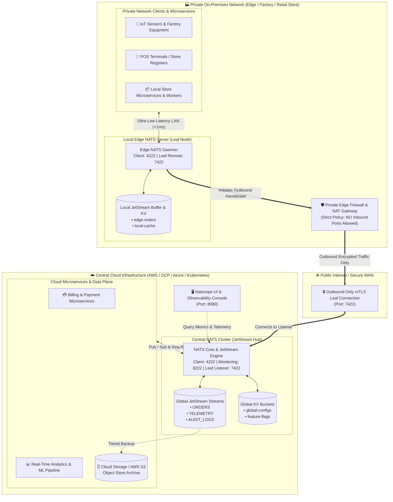
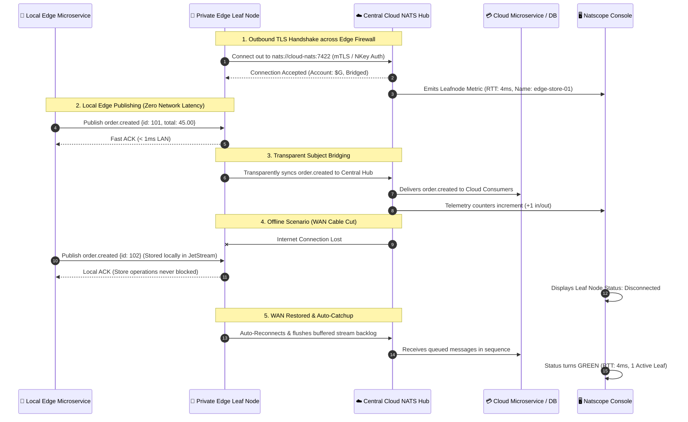

# Cloud-to-Edge Hybrid Architecture with NATS Leaf Nodes

This document details the enterprise hybrid-cloud architecture pattern using **NATS Leaf Nodes**, connecting private on-premises edge networks (retail stores, factory floors, branch offices, IoT gateways) to a central cloud cluster (AWS / GCP / Azure / Kubernetes), observed and managed by **Natscope**.

---

## 🏛️ High-Level Architecture Diagram



---

## ⚡ Why This Architecture Solves Private Network Edge Challenges

### 1. Zero Inbound Firewall Holes (NAT Traversal)
- In traditional messaging architectures (Kafka, RabbitMQ, MQTT), bridging private branch offices requires opening inbound firewall ports or configuring fragile site-to-site IPsec VPN tunnels.
- **NATS Leaf Nodes solve this natively**: The Leaf Node in the private network **initiates an outbound TLS connection** on port `7422` to the cloud hub. Because the connection is outbound-only, it traverses stateful NAT and enterprise firewalls transparently with **zero inbound ports exposed**.

### 2. Local Autonomy & 100% Offline Survivability
- If the WAN or public internet connection drops:
  - Local microservices, POS terminals, and IoT sensors **continue operating at zero latency (<1ms)** against the local Edge NATS server.
  - Messages and KV mutations are stored safely in the local JetStream buffer.
- When internet connectivity is restored:
  - The Leaf Node automatically reconnects to the cloud hub.
  - Queued messages, state revisions, and stream sequences seamlessly synchronize without data loss.

### 3. Subject Namespace Scoping & Multi-Tenancy
- Edge nodes can be scoped to specific multi-tenant accounts (e.g. `Account: store-104` or `Account: factory-berlin`).
- Central Cloud applications can broadcast configurations down to all edge nodes (e.g. `configs.broadcast`), while each edge node isolates its telemetry to `edge.store-104.>`.

---

## 🔄 Bidirectional Message & Synchronization Flow



---

## 🛠️ Production Configuration Templates

### 1. Central Cloud Hub Configuration (`cloud-central.conf`)
Deploy this on your central Kubernetes cluster or Cloud VM:

```hocon
# Server Identification
server_name: "cloud-central-hub"
port: 4222
http_port: 8222

# JetStream Engine
jetstream {
  store_dir: "/data"
  max_mem: 4G
  max_file: 50G
}

# Leaf Node Ingress Listener (Accepts Outbound connections from private branches)
leafnodes {
  port: 7422

  # Production Security: Enforce TLS & Authorization
  tls {
    cert_file: "/etc/nats/certs/server-cert.pem"
    key_file:  "/etc/nats/certs/server-key.pem"
    ca_file:   "/etc/nats/certs/ca.pem"
    verify_and_map: true
  }
}
```

---

### 2. Private Edge Leaf Node Configuration (`private-edge-leaf.conf`)
Deploy this inside the branch office, factory floor, or local Docker host:

```hocon
# Edge Server Identification
server_name: "edge-branch-leaf-01"
port: 4222
http_port: 8222

# Local JetStream Caching for Offline Resilience
jetstream {
  store_dir: "/edge-data"
  max_mem: 512M
  max_file: 5G
}

# Outbound Connection to Central Cloud (Zero Inbound Firewall Ports)
leafnodes {
  remotes = [
    {
      url: "tls://central-nats.mycloud.com:7422"
      credentials: "/etc/nats/tokens/edge-leaf-01.creds"

      # Optional subject mapping (Route edge topics to unique cloud prefixes)
      # import = [{ service: { subject: "cloud.services.>" } }]
      # export = [{ stream: { subject: "edge.branch-01.>" } }]
    }
  ]
}
```

---

## 🔍 Observability in Natscope

Natscope gives cloud and DevOps teams full visibility into the state of private leaf nodes without needing direct access to the edge local network:

1. **🌿 Connected Leaf Nodes Dashboard (`📡 Core NATS & Clients`)**:
   - **Name & Edge Identifier**: View which branch or factory is currently connected.
   - **Round-Trip Time (RTT)**: Live network latency measurement (e.g. `🟢 4.2ms`) to detect WAN network degradation.
   - **Direction & Role**: Displays `Hub (Inbound Leaf)` or `Spoke`.
   - **Account Scoping**: Identifies which NATS multi-tenant account is bridged.
   - **Network Throughput**: Live In/Out message rate and byte counters.
2. **Cluster Health Overview (`⚙️ Server & Cluster Info`)**:
   - High-level metric card displaying total **Connected Leaf Nodes: X Active**.
3. **Internal vs Microservice Filter**:
   - Easily toggle between your business microservice connections and internal management clients.
